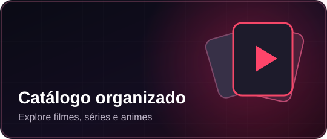
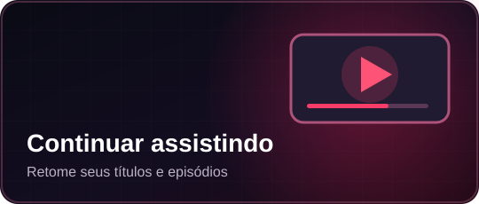
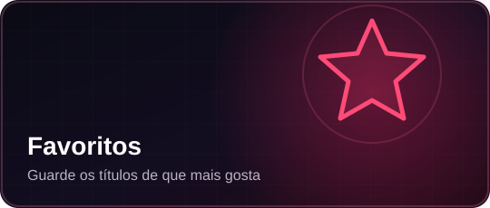

  

  <strong>Filmes, séries e animes em um só lugar.</strong>

O **Cineluvra** é um aplicativo Android com navegação organizada para explorar filmes, séries e animes, pesquisar títulos e salvar seus favoritos. O aplicativo foi desenvolvido para uma experiência simples e visualmente agradável no celular.

## Conheça o Cineluvra

| Catálogo | Continuar assistindo | Favoritos |
|:---:|:---:|:---:|
|  |  |  |
| Explore categorias e descubra títulos. | Volte aos títulos e episódios acessados. | Guarde seus conteúdos preferidos. |

Além dessas funções, o aplicativo conta com **pesquisa** para localizar títulos com mais facilidade.

*As imagens desta página são artes ilustrativas originais. Não representam capturas de tela reais nem garantem a disponibilidade de reprodução dos títulos.*

## Download oficial para Android

### [Baixar a versão mais recente do Cineluvra](https://github.com/SrDanvers/cineluvra-atualizacoes/releases/latest)

Na página de download, abra a seção **Assets** e selecione o arquivo `.apk`.

**Versão oficial publicada: 2.0.6** — APK disponível na Release v2.0.6. O arquivo `update.json` reflete a versão publicada.

[Detalhes da versão 2.0.6](https://github.com/SrDanvers/cineluvra-atualizacoes/releases/tag/v2.0.6)

## Atualizações

As atualizações oficiais são disponibilizadas na seção **Releases**. O `update.json` é sincronizado com a publicação oficial. Os projetos de desenvolvimento 2.0.8 e 2.0.9 estão guardados separadamente, não constam como versões oficiais publicadas. A versão 2.1.0 está em preparação. O arquivo `catalogo-extra.json` permite adicionar metadados de novos títulos por atualização remota, sem autorizar reprodução de obras protegidas.

A reprodução dos conteúdos depende da disponibilidade das fontes de vídeo utilizadas.

---

  <strong>CRIADO POR DENNY XIMENES</strong> 
  Cineluvra — Aplicativo Android

